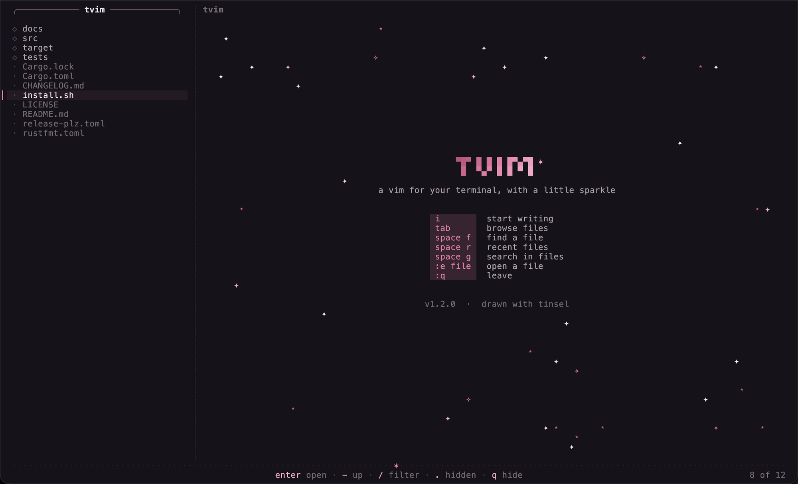
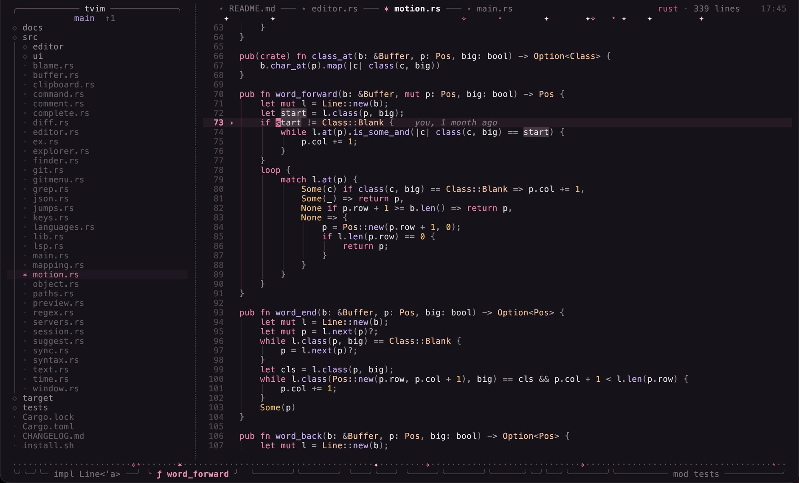

# tvim

tvim is a text editor for the terminal that uses vim's keys. If you already use vim, most of what your fingers do will just work. This page covers getting it running, what's different from vim, and the extra bits.





## Install

On macOS or Linux:

```sh
curl -fsSL tvim.shiv.mov | sh
```

Or with Homebrew:

```sh
brew install borhara/tap/tvim
```

Or, with Rust installed:

```sh
cargo install tvim
```

tvim looks for a newer version once a day. Installed by the script, it offers to update itself
when it starts; installed by Homebrew or cargo, it says what to run. `tvim --update` checks
straight away, and `set noupdatecheck` in your config stops it looking.

## Opening files

```sh
tvim notes.md             # edit a file
tvim .                    # browse a folder in the sidebar
tvim                      # reopen what was open here last time, or browse this folder
tvim +42 src/main.rs      # start on line 42
tvim +/TODO src/lib.rs    # start on the first TODO
tvim docs/screenshot.png  # look at a picture
```

Files reopen at the line you left them on, and `u` still undoes the changes you saved last time, as long as the file hasn't been changed outside tvim since. A very big file keeps only its most recent changes, so it still opens quickly.

Pictures (PNG, JPEG and GIF) open at full resolution, fitted to the window, in kitty, Ghostty, Konsole, iTerm2 and WezTerm. Other terminals, and tmux, say they can't show them. Pictures are only for looking at: tvim won't change or write them.

## Coming from vim

Normal, insert, replace and visual modes work as you'd expect, along with motions, operators, text objects, counts, registers, marks, macros, `.`, undo and redo, and the usual `:` commands (`:w`, `:q`, `:s`, `:g`, `:m`, `:t`, `:sort`, `:e`, `:normal`, ranges and so on). A few things behave differently:

- **Search** uses regular expressions the way most other tools write them, so `(a|b)+` and `\d{3}` work without extra backslashes. Search ignores case unless you type a capital. Use `\c` or `\C` in the pattern to force it either way. `:s` shows its change on the lines in view while you type it, and makes it only when you press `Enter`.
- **`Tab`** in normal mode moves between the file and the sidebar. Terminals send the same key for `Ctrl-i`, so straight after `Ctrl-o` it goes forward through jumps instead.
- **Brackets and quotes** close themselves as you type. Turn this off with `:set noap`.
- **Opening another file** never asks you to save first. Unsaved files stay open with a dot next to their name, and `:q` won't quit while any are left.
- **`|`** runs one `:` command after another, as in `:w | bn`. `:s`, `:g` and `:normal` take the rest of the line as it is, so patterns such as `(a|b)` still work.
- **`!`** with a motion, or `:{range}!cmd`, runs the lines through a shell command and puts what it prints in their place, as in `!ip sort` or `:%!jq .`. `:r !cmd` puts what a command prints below the cursor. A command that fails leaves the text as it was and shows its error.
- **`gq`** rewraps lines to `textwidth`, or 79 columns when it's 0, keeping comment markers and list bullets, and `gw` does the same without moving the cursor. With `textwidth` set, typing past it breaks the line: any line in Markdown and plain text, and only comments in code.
- **`Alt-j` and `Alt-k`** move the line down and up, or the selected lines in visual mode, as in LazyVim. In insert mode Alt still works as Esc, so `Alt-j` there leaves insert mode and moves down.
- **`gcc`** comments or uncomments a line, and `gc` works with a motion or in visual mode.
- **`gd`, `gr` and `K`** ask the file's language server, as they do in most Neovim setups, rather than searching the file, replacing characters or running `man`. So does **`=`**, which formats lines instead of reindenting them.
- **Block visual mode** starts with `Ctrl-v`, or `Ctrl-q` if your terminal keeps `Ctrl-v` for pasting. `>` and `<` move the text from the block's left edge rather than whole lines.

## Extras

`Space` is the leader key. Pause after pressing it, or after `d`, `c`, `y`, `g`, `z`, `"`, `@` or `'`, and a strip along the bottom shows what can come next.

| Keys | What it does |
| --- | --- |
| `Space f` or `Ctrl-p` | Find a file by name |
| `Space r` | Files you opened recently |
| `Space g` or `Space /` | Search every file in the project |
| `Space b` | Open files |
| `Space G` | Git menu |
| `Space m` | Markdown preview |
| `Space n` | Rename what's under the cursor, with a language server |
| `Space c` | Code: `a` for what the language server can do here, `f` formats the file |
| `Space s` / `Space S` | Symbols in the file, or across the project |
| `Space x` | Problems in every open file |
| `Space z` | Zen mode: just the text, centred |

**Surround.** `ys` with a motion or text object and then a bracket or quote puts that pair around the text, so `ysiw)` turns `foo` into `(foo)`. `yss` does the whole line, and `S` does a selection in visual mode, each row on its own in block mode. `ds"` takes away the quotes around the cursor, and `cs"'` swaps them for single quotes. An opening bracket, as in `ysiw(`, puts spaces inside, and with `ds(` or `cs(` it takes them away. LazyVim's names work too: `gsa` for `ys`, `gsd` for `ds` and `gsr` for `cs`.

**Several cursors.** `Ctrl-n` selects the word under the cursor (or what's selected on one line), and each `Ctrl-n` after it the next one like it. `Ctrl-x` skips the last one for the one after, and `Ctrl-p` lets it go. Then `c` changes them all, typing at each, `i` and `a` type before or after each, `d` deletes them and `y` copies the word. `Esc`, or any other key, goes back to one cursor. As in vim-visual-multi, this takes `Ctrl-n` from moving down a line.

**Sidebar.** `tvim .`, `Tab` or `:Lex` opens a folder tree beside the text. Use `j`/`k` to move, `Enter` to open, and `l`/`h` to open and close folders. `-` goes up a folder, `.` shows hidden files, `/` filters, and `q` hides the sidebar.

**Git.** The git menu lists staged, changed and untracked files with a diff beside them. `s` stages, `c` commits, `d` discards, `l` shows the log, `b` lists branches, and `p`/`P` pull and push. Lines you've changed since the last commit are marked in the gutter. The line under the cursor shows who last changed it and when, which `:set nogl` turns off.

**Language servers.** When a language server is installed for the file you open, tvim starts it and keeps it up to date as you type. Lines with problems get a coloured line number, the problem itself is tinted, and the cursor's line says what's wrong. `]d` and `[d` go to the next and previous problem.

As you type, what the server suggests shows below the cursor, saying what each is. Nothing goes in until you choose: `Ctrl-n` and `Ctrl-p` (or the arrow keys) move through the list putting each in, `Ctrl-y` takes the one chosen, or the first, and `Ctrl-e` puts back what you typed. Anything else carries on as usual, so `Enter` still starts a new line. `Ctrl-n` on its own asks for suggestions, or offers words from the open files where there's no server. `:set noacp` keeps the list away until you press `Ctrl-n`.

Typing a call, as in `area(`, shows what the function takes above the cursor, with the parameter you're typing picked out, until you leave the call or insert mode.

The server also knows what the code means, so with the cursor on a name:

| Keys | What it does |
| --- | --- |
| `gd` | Go to where it's defined. `Ctrl-o` comes back |
| `gr` | List everywhere it's used, with a preview. Type to narrow the list |
| `K` | Show its type and docs beside the cursor, until the next key |
| `Space n` or `:rename new_name` | Rename it in every file. Files it changes are left unsaved, and `:wa` saves them |
| `Space s` | List what's defined in the file. Type to narrow the list |
| `Space S` or `:Symbols name` | List what's defined across the project with that name |
| `Space x` | List the problems in every open file, worst first, to go through with `]q` and `[q` |
| `Space c a` | List what the server can do here, such as fixing the problem on the line or adding an import, and do the one you choose. In visual mode it's about what's selected |

The server can tidy the code too. `Space c f` or `:Format` formats the file, and `=` formats the lines it covers, so `==` does one line, `=ip` a paragraph and `:10,20Format` those lines. Each is one change for `u` to undo. `:set formatonsave` formats every file before it's written, if its server answers within two seconds.

tvim knows these servers, and runs whichever you have:

| Files | Server | Install |
| --- | --- | --- |
| Rust | `rust-analyzer` | `rustup component add rust-analyzer` |
| Python | `pyright-langserver --stdio` | `npm i -g pyright` |
| Go | `gopls` | `go install golang.org/x/tools/gopls@latest` |
| TypeScript and JavaScript | `typescript-language-server --stdio` | `npm i -g typescript typescript-language-server` |
| C and C++ | `clangd` | comes with Xcode, or `brew install llvm` |
| Lua | `lua-language-server` | `brew install lua-language-server` |
| Zig | `zls` | `brew install zls` |
| Shell | `bash-language-server start` | `npm i -g bash-language-server` |

`:lsp` says which server the file has and how it's doing, or why it isn't running, and `:lsp restart` starts them all again. To run something else, or nothing, put a line in your config:

```
lsp python pylsp
lsp go off
```

**Quickfix list.** `Ctrl-q` in a search, or in any list of places such as `gr` or `Space x`, keeps what's listed (narrowed to what you've typed) as the quickfix list. `]q` and `[q` (or `:cn` and `:cp`) go to the next and previous place, `:cfirst`, `:clast` and `:cc 3` to others, and `:copen` lists them again. `:cdo cmd` runs a `:` command at each place and `:cfdo cmd` once in each file, so a search for `old_name` then `Ctrl-q` and `:cfdo %s/old_name/new_name/g` replaces it across the project. `:wa` saves the files changed.

**Several files.** Open files are listed along the top. Switch with `gt`/`gT`, `:b name` or `:bn`/`:bp`, and close one with `:bd`. `:wa` saves them all.

**Folds.** A line folds the lines indented under it, along with a closing `}` or `end`. `zc` closes the fold around the cursor, `zo` opens it and `za` does whichever it isn't. `zM` closes them all and `zR` opens them all. A closed fold shows as its first line and how many it hides. `j` and `k` step over it, and `dd` or `yy` on it takes all of it. Searching or going to a mark inside one opens it.

**Splits.** `Ctrl-w s` and `Ctrl-w v` (or `:sp` and `:vs`) split the window. `Ctrl-w` with `h`/`j`/`k`/`l` moves between windows and `Ctrl-w q` closes one.

**Colours.** Syntax colouring covers Rust, Python, JavaScript and TypeScript, Go, C and C++, Java, shell, Lua, TOML, YAML, JSON and Markdown. tvim uses its own colour scheme rather than your terminal's, and switches to a light one on a light background.

## Settings

Put `:set`, `:map` and `:lsp` lines in `~/.config/tvim/config`, one per line:

```
set tabstop=2 noexpandtab
set relativenumber
inoremap jk <Esc>
nnoremap <leader>w :w<CR>
```

`:set` on its own lists every option with its current value. The ones you're most likely to want:

| Option | Short | Default | |
| --- | --- | --- | --- |
| `number` | `nu` | on | line numbers |
| `relativenumber` | `rnu` | off | count lines from the cursor |
| `zeropad` | `zp` | off | line numbers start with zeros, as in `01` |
| `tabstop` | `ts` | 4 | how wide a tab shows |
| `shiftwidth` | `sw` | 4 | how far `>>` and `<<` move |
| `expandtab` | `et` | on | `Tab` types spaces |
| `ignorecase` | `ic` | on | search ignores case |
| `smartcase` | `scs` | on | unless the search has capitals |
| `scrolloff` | `so` | 3 | lines kept above and below the cursor |
| `timeoutlen` | `tm` | 1000 | milliseconds to wait for the rest of a mapping |
| `autopairs` | `ap` | on | brackets and quotes close themselves |
| `smooth` | `sm` | on | scroll smoothly on big jumps |
| `gitlens` | `gl` | on | show who last changed the cursor's line |
| `lsp` | | on | run language servers |
| `autocomplete` | `acp` | on | show a language server's suggestions as you type |
| `formatonsave` | `fos` | off | the language server tidies a file before it's written |
| `roomy` | `ro` | on | a little space above and below the text |
| `dim` | | on | fade the sidebar while you're in the file, and the other way round |
| `wrap` | | off | long lines carry on in the rows below; `gj` and `gk` move a row at a time |
| `linebreak` | `lbr` | off | with `wrap`, break lines between words |
| `textwidth` | `tw` | 0 | how wide `gq` makes lines, and where typing breaks them |
| `undofile` | `udf` | on | keep undo history when you save, to undo after reopening |
| `updatecheck` | `uc` | on | look for a newer tvim once a day, and offer it when tvim starts |

### Key mappings

Mappings work as in vim. `:nnoremap`, `:xnoremap`, `:inoremap` and `:cnoremap` map keys in normal, visual, insert and command-line mode, and `:onoremap` maps the keys typed after an operator such as `d`. `:noremap` covers normal, visual and after an operator, and `:noremap!` covers insert and the command line. The `map` forms (`:nmap`, `:imap` and so on) let the new keys run other mappings too. `<leader>` is `Space`, and `<Nop>` maps keys to nothing.

`:nunmap` and its siblings remove a mapping, and `:mapclear` removes them all. `:map`, `:nmap` and the rest list mappings when given no keys to map to.

When some keys could be the start of a longer mapping, tvim waits `timeoutlen` milliseconds for the rest before running them as they are.

## Contributing

```sh
cargo test
cargo clippy --all-targets
```

The editor doesn't need a terminal to run, so tests type keys in vim's notation and check the result:

```rust
let mut e = Editor::with_text("one two");
e.keys(&tvim::keys::parse("cwhello<Esc>"));
assert_eq!(e.text(), "hello two");
```
